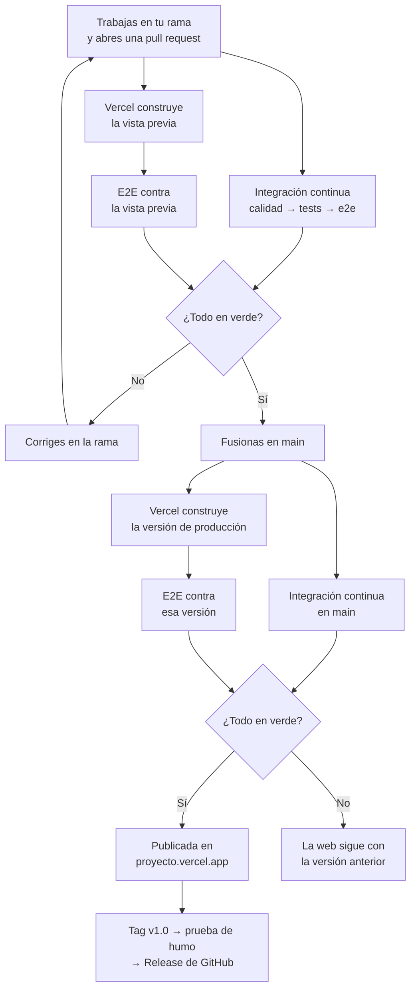

# Proyecto DOM · Aplicación de gestión con integración y despliegue continuos

En este proyecto vas a recorrer **el camino completo de un cambio en una aplicación real**: desde que lo escribes en tu rama hasta que está publicado en Internet. Por el camino, el cambio se prueba en cada paso y nada llega a los usuarios sin haber pasado las pruebas.

- **Pruebas:** unitarias, de integración y de extremo a extremo, con un umbral de cobertura.
- **Integración continua:** un *workflow* de GitHub Actions comprueba cada cambio en varios trabajos encadenados.
- **Despliegue continuo:**
  - **Vercel** publica tu web, pero solo lo que pasa las pruebas;
  - cada *pull request* tiene su vista previa, que también se prueba;
  - cada versión se publica como Release de GitHub.

La aplicación que se prueba y se despliega es tuya: una **aplicación web de gestión** sobre el tema que elijas (el alquiler de unas pistas, una colección de discos, el inventario de un taller…). Tiene:

- inicio de sesión, registro, roles y una zona de administración;
- un **CRUD** guardado en el navegador, con buscador y paginación;
- un formulario con validación en tiempo real y expresiones regulares;
- la propagación de eventos usada y explicada.

Es JavaScript sin librerías (salvo el CSS de Bootstrap) y **sin APIs remotas**. Junta lo visto de la UD2 a la UD6. Lo harás en **tres sprints** y lo presentarás en una **exposición** individual.

**CE:** RA2 b, c, d, e, f, g, h · RA4 a, b, d, e, g, h, i, j, k · RA3 a, b, e, g · RA6 c, d, h · RA5 a, b, c, d, e, f, g, h

## El camino de un cambio

Este diagrama muestra lo que tendrás montado al final del proyecto. Lo construirás poco a poco: la integración continua en los sprints 1 y 2, y el despliegue continuo en el sprint 3.



Fíjate en las dos decisiones: **nada se fusiona** sin pasar las comprobaciones de la *pull request*, y **nada se publica** sin pasar las de `main`. Si algo falla, los usuarios no lo notan: siguen viendo la última versión buena.

## Cómo se organiza el trabajo

### Tres sprints

Un **sprint** es un periodo corto de trabajo con un objetivo cerrado: al terminarlo, lo hecho funciona y está probado, aunque aún falten partes. Cada sprint se revisa en clase y termina con una **etiqueta** (*tag*) de Git que marca esa versión.

| Sprint | Objetivo | Requisitos | Al cerrarlo |
|--------|----------|------------|-------------|
| 1 | Usuarios, sesión y roles, con sus tests y la **primera integración continua** | 1–12 | *Tag* `v0.1` y su reflexión en el README |
| 2 | El CRUD y la zona de administración, con todas sus pruebas y la **integración continua completa** | 13–23 | *Tag* `v0.2` y su reflexión |
| 3 | El **despliegue continuo** completo y la entrega | 24–29 | *Tag* `v1.0`, su Release y su reflexión. **Es la versión que se corrige** |

El profesor fija en Classroom las fechas de cada sprint. Se corrige con la rúbrica **solo la versión `v1.0`**; las revisiones de los sprints 1 y 2 son para que recibas comentarios a tiempo.

### El tablero

Organiza tus tareas en un tablero de **Trello** con tres columnas: **Por hacer**, **Haciendo** y **Hecho**. Cada tarjeta es una tarea pequeña (de unas horas, no «hacer el listado») e indica:

- el sprint al que pertenece (con una etiqueta de Trello);
- una descripción clara de qué hay que hacer;
- sus dependencias, si las tiene («necesita el módulo de usuarios»).

Comparte el tablero con el profesor al empezar. Lo revisaréis en clase; no forma parte de la nota.

### La Definición de Hecho

La **Definición de Hecho** (*Definition of Done*) es la lista de condiciones que tiene que cumplir una tarea para pasar a «Hecho». Por ejemplo, «tiene sus tests» o «el *workflow* está en verde». Escribe la tuya en la sección «Organización del trabajo» del README **durante el sprint 1**, aplícala en todo el proyecto y revísala en cada reflexión. Cada condición tiene que poder comprobarse: «el código está bien» no sirve.

### El blog del proyecto

Crea una carpeta **`blog/`** con un **`README.md`**: es tu diario de aprendizaje del proyecto. Escríbelo mientras trabajas, no al final, con **al menos una entrada por sprint**. Cada entrada lleva la fecha y el sprint, y cuenta:

- **Las principales dificultades** que has encontrado y **cómo las has resuelto**: qué pasaba, qué probaste, qué funcionó y qué aprendiste. Por ejemplo, un test que fallaba solo en el *workflow*, una versión que Vercel no publicaba o un oyente que no recibía el evento.
- **Los problemas conceptuales:** lo que no entendías o entendías mal (la fase de captura, por qué un test es de integración y no unitario, qué hace `needs`, qué es una vista previa…) y su **explicación con tus palabras**, con un ejemplo de tu código.

No vale una lista de tareas hechas: eso ya está en el tablero. Escribe para alguien que empieza el mismo proyecto: qué le contarías para ahorrarle tiempo. El profesor puede preguntarte en la exposición por lo que cuentas.

### Git y GitHub

- `main` es la rama de **producción**: lo que hay en ella es lo que se publica.
- Cada funcionalidad se hace en **su rama** (`registro`, `listado`, `zona-administracion`…) y llega a `main` con una ***pull request***, que fusionas cuando sus comprobaciones están en verde. **No borres las ramas** al fusionarlas: son parte de la historia del proyecto.
- Elige si integras con ***merge*** o con ***rebase*** y justifícalo en el README.
- Al cerrar cada sprint, crea su *tag* y súbelo:

  ```bash
  git tag v0.1
  git push origin v0.1
  ```

- Escribe tu propio `.gitignore`: qué no se sube y por qué.
- Haz commits pequeños y frecuentes, con mensajes que digan qué cambia.

## Entorno de trabajo

Este proyecto trae su Dev Container en `.devcontainer/`, como los ejercicios de la UD5 con pruebas de extremo a extremo. Construye su imagen con el `Dockerfile` de esa carpeta, a partir de `node:24-bookworm`, y el `Dockerfile` instala Chromium para Playwright con las librerías del sistema que necesita.

1. Abre en VS Code **la carpeta del repositorio**, la que contiene `.devcontainer/`.
2. Ejecuta **Dev Containers: Reopen in Container**. La primera vez tarda bastante, porque descarga la imagen, la construye y descarga el navegador.
3. Al crearse, el contenedor ejecuta `npm install`. Al abrirse, arranca el servidor de la web (`serve`, en el puerto **3901**). Ábrela en <http://localhost:3901>; si no responde, búscala en el panel **Puertos** de VS Code.

La web usa módulos, así que necesita un servidor: no abras los HTML con doble clic. El `serve.json` del punto de partida evita que `serve` quite los parámetros de direcciones como `ficha.html?id=r3` (lo viste en la UD4). Ejecuta los tests, las pruebas de extremo a extremo, ESLint y Prettier en la terminal de VS Code, que ya es la del contenedor.

## Elige tu tema

Elige un tema que te interese y que no sea una copia de los ejemplos de clase. Ten en cuenta que la **entidad** del CRUD tiene que cumplir los mínimos del requisito 13 (campos, campo condicional, grupo dinámico y validadores): elige un tema en el que tengan sentido.

Describe tu tema en la sección **«Mi proyecto»** del `README.md` en el sprint 1 y mantenla al día. Es la referencia con la que se corrigen tus formularios.

> ⚠️ **Cuidado**: Tu repositorio y la web publicada en Vercel son **públicos**. No uses datos reales de nadie, ni en el código ni en los ejemplos.

## Punto de partida

```text
├── .devcontainer/                ← el entorno (no se modifica)
├── package.json                  ← scripts y dependencias, con Bootstrap
├── playwright.config.js · serve.json · jsdoc.json   (no se modifican)
├── vitest.config.js              ← completarás su sección de cobertura
├── eslint.config.js · .prettierrc · .prettierignore (añadirás reglas a ESLint)
├── js/clave.js                   ← resumirClave: el resumen SHA-256 de una contraseña (no se modifica)
├── scripts/construir.js          ← npm run build: copia la web a dist/ (no se modifica)
├── tests/
│   ├── AlmacenFalso.js · pagina.js   ← ayudas para los tests (no se modifican)
│   ├── unitarios/ejemplo.test.js     ← un test de ejemplo, que sustituirás por los tuyos
│   └── integracion/ejemplo.test.js   ← otro
├── e2e/ejemplo.spec.js           ← una prueba de extremo a extremo de ejemplo
├── blog/README.md                ← tu blog del proyecto, con la plantilla de una entrada
└── README.md                     ← plantilla de entrega
```

No hay páginas, ni módulos de la aplicación, ni *workflows*: los escribes tú. Para los módulos, una organización que funciona bien, y que puedes seguir o cambiar:

- **Datos:** un módulo por cada cosa que guardas (usuarios, sesión, registros). Cada uno recibe el almacenamiento como parámetro, así que puedes probarlo con `AlmacenFalso` en lugar de `localStorage`, como en la UD4.
- **Lógica pura:** validadores y `paginar`, sin DOM. Son los más fáciles de probar.
- **Páginas:** un módulo por página, con una función que la inicia. Recibe lo que necesita (el almacenamiento, la sesión, cómo navegar) en lugar de usar directamente `localStorage` o `location`. Así los tests de integración pueden sustituirlo.
- **Componentes comunes:** los avisos, la paginación, la validación de un formulario.

Explica la tuya en la sección «Arquitectura y módulos» del README.

`playwright.config.js` lee la variable de entorno **`BASE_URL`**:

- **sin ella**, arranca `serve` y prueba en `http://localhost:3901`;
- **con ella**, no arranca nada y prueba la dirección que le des. Así las mismas pruebas sirven para tu equipo, para el *workflow* y para la web desplegada:

  ```bash
  BASE_URL=https://mi-proyecto.vercel.app npm run e2e
  ```

## Requisitos

### Sprint 1 · Usuarios, sesión, roles y primera integración continua (`v0.1`)

1. **Organización:**
   - crea el tablero de Trello y compártelo con el profesor;
   - completa «Mi proyecto» (lo que pide «Elige tu tema» y la tabla de páginas);
   - escribe tu Definición de Hecho.
2. **Páginas y aspecto:**
   - las cinco páginas, con el nombre que fija el contrato: `index.html` (iniciar sesión), `registro.html`, `listado.html`, `ficha.html` y `usuarios.html`. Las que aún no programes pueden quedarse con su título y su cabecera;
   - todas enlazan el CSS de Bootstrap desde `node_modules/bootstrap/dist/css/bootstrap.min.css` y una hoja propia `css/estilos.css`;
   - **solo el CSS de Bootstrap:** no uses su JavaScript. El menú, los diálogos y los avisos los programas tú;
   - las páginas privadas comparten una cabecera con un menú: el listado y, **solo para los administradores**, «Usuarios». Muestran el usuario actual y su rol, y tienen el botón «Cerrar sesión»;
   - cada página tiene una región para los avisos con `role="status"`.
3. **Usuarios y sesión:**
   - los usuarios se guardan en `localStorage` y la sesión (el usuario y su rol), en `sessionStorage`;
   - las contraseñas se guardan **solo** como resumen, calculado con `resumirClave` de `js/clave.js`;
   - las lecturas no fallan si lo guardado está estropeado: devuelven un valor por defecto.

   > 📝 **Nota del Profesor**: `resumirClave` devuelve una **promesa**, porque el navegador calcula el resumen sin bloquear la página. Las promesas son de la UD7. Hasta entonces, úsala con esta fórmula: marca como `async` la función que la llama y escribe `const resumen = await resumirClave(clave);`. Es lo mismo que hiciste con Playwright en la UD5.

4. **Roles:**
   - hay dos roles: **usuario** y **administrador**;
   - el **primer usuario que se registra es administrador**; los demás se registran como usuarios.
5. **Registro** (`registro.html`):
   - campos: un nombre de usuario (con un validador con expresión regular y que no esté ocupado), el correo, la contraseña y su repetición, y una casilla de aceptación;
   - mientras se escribe la contraseña, se ven los requisitos que cumple: longitud, minúscula, mayúscula y cifra, con `\p{Ll}` y `\p{Lu}`;
   - al registrarse, entra con la sesión iniciada, deja un aviso y va al listado.
6. **Inicio de sesión** (`index.html`):
   - si ya hay sesión, va directamente al listado;
   - con la contraseña incorrecta, avisa, vacía la contraseña y le da el foco;
   - mientras se calcula el resumen, el formulario está en estado de envío y un segundo envío (otro clic o Intro) **no** hace nada. El registro lo controla igual.
7. **Páginas privadas:**
   - sin sesión, llevan a `index.html` con `location.replace`;
   - `usuarios.html`, con un usuario que no es administrador, lleva al listado con un aviso de error;
   - «Cerrar sesión» borra la sesión y vuelve a `index.html`.
8. **Avisos:**
   - una función lanza desde cualquier elemento el evento propio `aviso` (`CustomEvent` con `bubbles: true` y `detail: { mensaje, tipo }`);
   - un único oyente en `document` lo muestra en la región de avisos, con las clases de alerta de Bootstrap según el tipo;
   - un aviso se puede dejar guardado para la página siguiente («Te has registrado», al llegar al listado).
9. **Calidad:**
   - añade a `eslint.config.js` al menos **tres reglas** que no estén ya (por ejemplo, `camelcase`, `no-var`, `eqeqeq`, `prefer-const` o `no-console`). Explica en el README qué comprueba cada una y por qué la quieres;
   - `npm run lint` y `npm run format:check` sin errores.
10. **Primeros tests unitarios**, en `tests/unitarios/`:
    - tus módulos de datos (usuarios y sesión) con `AlmacenFalso`: guardar y leer, el primer usuario es administrador, un nombre repetido, la contraseña correcta e incorrecta y **los datos estropeados**;
    - los validadores del registro, con tablas `it.each`: casos válidos (con los límites) y un caso no válido por cada regla, con su motivo.
11. **Integración continua, paso 1:** el *workflow* con los trabajos de calidad y de tests (apartado «Integración continua»).
12. **Cierre del sprint 1:**
    - el trabajo llega a `main` por *pull requests*, con el *workflow* en verde;
    - la entrada del sprint 1 en el blog;
    - crea el *tag* `v0.1` y escribe la reflexión del sprint en el README.

### Sprint 2 · El CRUD, la zona de administración y la integración continua completa (`v0.2`)

13. **Tu entidad** tiene como mínimo:
    - **cinco campos** con al menos **tres tipos de control** distintos: texto, número, fecha, lista desplegable, botones de opción, casilla…;
    - un **campo condicional**, que solo se ve y se envía según lo elegido en otro (como «Motivo» cuando un vehículo está en el taller);
    - un **grupo de campos dinámico**, que se añade y se quita desde un `<template>`, con un mínimo y un máximo (como de 0 a 3 extras);
    - al menos **tres validadores con expresiones regulares** propios de tu tema. Uno de ellos comprueba además con código una regla de estructura o de control: la letra de un DNI, el dígito de control de un ISBN o de un IBAN…
14. **Registros:**
    - los registros de **cada usuario** van en `localStorage`, en JSON, en una clave propia de ese usuario. Cada usuario ve solo los suyos;
    - cada registro tiene un `id` único;
    - las lecturas no fallan si lo guardado está estropeado.
15. **Listado** (`listado.html`):
    - un elemento por registro, creado desde un `<template>` y rellenado con `textContent` y atributos (ni `innerHTML` con datos, ni estilos en el JavaScript), sustituyendo el contenido de una vez;
    - en cada uno, un enlace «Editar» a `ficha.html?id=…` y un botón «Borrar» que pide confirmación en un `<dialog>`;
    - un buscador con _debounce_ que no distingue mayúsculas ni tildes, un contador de resultados y un mensaje cuando no hay nada que mostrar;
    - la paginación del requisito 16.
16. **Paginación**, común al listado y a la zona de administración:
    - una función pura `paginar(lista, pagina, porPagina)` que devuelve los elementos de esa página, la página corregida (una página que no existe se corrige a la más cercana que sí existe) y el total de páginas;
    - unos controles «Anterior», los números de página y «Siguiente», creados desde el código. «Anterior» y «Siguiente» se desactivan en los extremos y la página actual se marca con `aria-current="page"`;
    - la página va en la dirección (`?pagina=2`, con `URLSearchParams` y `history.replaceState`): al recargar, sigues en la misma página;
    - al buscar, se vuelve a la página 1.
17. **Ficha** (`ficha.html` para dar de alta y `ficha.html?id=…` para editar):
    - los campos de tu entidad con sus validadores;
    - el campo condicional se muestra **y se activa** solo cuando corresponde (`hidden` y `disabled`);
    - el grupo dinámico se crea desde su `<template>`, con un `id` único por campo, su etiqueta (`htmlFor`) y su caja de error. Los botones de añadir y quitar se desactivan en los límites;
    - los atributos que dependen de la fecha de hoy (`min`, `max`) los pone el código;
    - los datos se leen con `FormData` (`getAll` para el grupo) y se guardan normalizados;
    - al editar, el formulario se rellena con el registro;
    - al guardar, se avisa y se vuelve al listado. Con un `id` que no existe, se vuelve al listado con un aviso de error.
18. **Zona de administración** (`usuarios.html`, solo para administradores):
    - el listado de usuarios con buscador y paginación (reutiliza la del requisito 16). Cada usuario muestra su nombre, su correo y su rol;
    - en cada fila, un botón para dar o quitar el rol de administrador;
    - un administrador **no puede quitarse el rol a sí mismo**, así siempre queda al menos uno. Su botón está desactivado y se explica por qué.
19. **Validación en tiempo real**, en los tres formularios (inicio de sesión, registro y ficha):
    - **cuándo:**
      - cada campo se valida por primera vez al **salir** de él, y desde entonces con cada cambio;
      - las reglas que dependen de otro campo (repetir la contraseña, un dato repetido) se revalidan cuando cambia el otro;
    - **cómo:**
      - los formularios llevan `novalidate`;
      - los mensajes salen de `validity` y de `setCustomValidity`;
      - tus validadores de formato están en un objeto que los reúne y se eligen por un atributo `data-validar` del campo;
    - **qué se ve:**
      - cada campo tiene su caja de error, enlazada con `aria-describedby`, y `aria-invalid`;
      - los estados se marcan con las clases de validación de Bootstrap (`is-invalid`, `invalid-feedback`), puestas por tu código;
      - al enviar con errores, se avisa y el foco va al primer campo con error.
20. **Eventos:**
    - **burbuja:** el listado, la paginación, la zona de administración y el grupo dinámico usan **delegación**, con un oyente en el contenedor que sirve también para los elementos que se crean después (`closest`). El evento `aviso` sube hasta `document`;
    - **captura:** un uso justificado de la fase de captura, como escuchar en el formulario un evento que **no sube** (`blur`) para la primera validación. No uses `stopPropagation` salvo en un caso concreto que expliques;
    - en la sección «Eventos» del README:
      - qué consigues con el HTML sin escribir oyentes (envío con Intro, `novalidate` y los atributos de validación, `<dialog>`, `label for`…) y por qué no usas atributos `on…`;
      - qué tipos de eventos usas y por qué cada uno frente a otros parecidos (`submit` frente a `click`, `input` frente a `change`, `blur` frente a `focusout`…);
      - una tabla con **todos** tus oyentes: evento, dónde se registra, en qué fase actúa y para qué.
21. **Pruebas**, cada nivel de la pirámide con lo que le toca (UD1, tema 6):
    - **unitarias**, además de las del sprint 1:
      - los validadores de tu entidad, con `it.each`;
      - `paginar`: la primera y la última página, una página que no existe y una lista vacía;
      - el módulo de registros con `AlmacenFalso`, incluidos los datos estropeados;
    - **de integración**, en `tests/integracion/`, en happy-dom (`tests/pagina.js` carga el `<body>` de una página). Cada página con sus módulos reales; solo sustituyes el almacenamiento (`AlmacenFalso`), el resumen de la contraseña (una función que devuelve una promesa) y la navegación (`vi.fn()`):
      - **la ficha:** la validación al salir y al escribir, y el envío con los datos exactos que se guardan;
      - **el listado:** la búsqueda (con temporizadores falsos, `vi.useFakeTimers()`, para el _debounce_) y el cambio de página;
      - **la protección por rol:** un usuario que no es administrador no puede quedarse en `usuarios.html`;
    - **de extremo a extremo**, en `e2e/`, dos recorridos, buscando los elementos como un usuario (`getByRole`, `getByLabel`, `getByText`):
      - **la sesión:** registrarse como primer usuario (ve «Usuarios» en el menú), cerrar sesión y volver a entrar;
      - **el CRUD:** dar de alta un registro, editarlo, borrarlo con confirmación y comprobar que lo guardado sigue al recargar la página;
    - **cobertura:** en `vitest.config.js`, mide la cobertura de tus funciones puras (validadores y `paginar`) con un **umbral** de al menos el 90 % de líneas. `npm run coverage` falla si no se llega.

> 📝 **Nota del Profesor**: Playwright abre un contexto nuevo en cada prueba, así que todas empiezan con el almacenamiento vacío: el primer usuario que registres en cada prueba será administrador. Escribe en `e2e/` funciones de ayuda para los pasos que se repiten (registrarse, dar de alta un registro) y llámalas desde cada prueba. Las pruebas son asíncronas: usa `async` y `await` como fórmula, como en la UD5. Escribe tus recorridos sin direcciones completas (`page.goto('/registro.html')`): así funcionan igual con `serve` que contra la web desplegada.

22. **Integración continua, paso 2:** el *workflow* completo, con el trabajo e2e, los artefactos, `concurrency`, el umbral y la insignia (apartado «Integración continua»).
23. **Cierre del sprint 2:**
    - el trabajo llega a `main` por *pull requests*, con el *workflow* en verde;
    - la entrada del sprint 2 en el blog;
    - crea el *tag* `v0.2` y escribe la reflexión del sprint.

### Sprint 3 · Despliegue continuo y entrega (`v1.0`)

24. **Vercel en producción:** tu web publicada en `https://<proyecto>.vercel.app`, que **solo** se actualiza cuando pasan las comprobaciones (apartado «Despliegue continuo», pasos 1 y 2).
25. **Vistas previas y pruebas contra lo desplegado:** cada *pull request* tiene su vista previa, y tus dos recorridos de Playwright se ejecutan contra ella y contra cada versión de producción antes de publicarla (pasos 3 y 4).
26. **Prueba de humo:** una prueba corta, `e2e/humo.spec.js`, que comprueba que la web publicada responde (paso 5).
27. **Releases:** al subir un *tag*, un *workflow* comprueba el proyecto, pasa la prueba de humo en producción y crea la Release de GitHub con la web en un zip (paso 5).
28. **Evidencias** en el README: las del apartado «Despliegue continuo».
29. **Documentación y entrega:**
    - JSDoc en todos los módulos: qué HTML necesita cada página, qué eventos escucha y lanza (`@listens`, `@fires`), `@typedef` de tus datos y `@example` en las funciones puras. `npm run docs` genera la documentación;
    - todas las secciones del README completas;
    - la entrada del sprint 3 en el blog;
    - `npm test`, `npm run coverage`, `npm run e2e`, `npm run lint`, `npm run format:check` y `npm run build` sin errores;
    - el *tag* `v1.0`, con su Release, y la reflexión del sprint 3.

## Integración continua

En los ejercicios de las unidades, el *workflow* era opcional. **Aquí es obligatorio y puntúa.** Escribe `.github/workflows/ci.yml` con estas orientaciones. Lo construyes en dos pasos: el primero en el sprint 1 y el segundo en el sprint 2.

### Paso 1 (sprint 1): calidad y tests

- **Cuándo se ejecuta:** con cada `push` y cada *pull request* a la rama `main`.
- **Permisos:** `permissions: contents: read`. El *workflow* solo lee el código.
- **Dos trabajos** (*jobs*), en `ubuntu-latest`, cada uno con un `name` en español y cada paso con un nombre que diga qué hace:
  1. **`Calidad`:**
     - descargar el código (`actions/checkout@v7`);
     - instalar Node.js 24 con la caché de npm (`actions/setup-node@v7`, `node-version: 24` y `cache: npm`);
     - `npm ci`;
     - `npm run lint` y `npm run format:check`;
  2. **`Tests`:** espera a `Calidad` (`needs`), con la misma preparación y `npm test`.
- Sube también `package-lock.json`, que creó `npm install` al abrir el contenedor: sin él, `npm ci` falla.
- Prettier también revisa el formato de tus *workflows*: ejecuta `npm run format` antes de subirlos.

Compruébalo: abre una *pull request* y mira en su pestaña **Checks** los dos trabajos, uno detrás de otro.

### Paso 2 (sprint 2): pruebas de extremo a extremo, artefactos e insignia

- **`Tests`** ejecuta `npm run coverage` en lugar de `npm test`: pasa los mismos tests y, además, comprueba el umbral. Sube la carpeta `coverage/` como **artefacto** (`actions/upload-artifact@v7`) para poder descargar el informe.
- **Un tercer trabajo, `E2E`:**
  - espera a `Tests` (`needs`): si ya fallan los tests, no se gastan minutos en instalar el navegador;
  - la misma preparación, instalar Chromium (`npx playwright install --with-deps chromium`) y `npm run e2e`;
  - un último paso que, **solo si algo ha fallado** (`if: failure()`), sube la carpeta `playwright-report/` como artefacto.
- **Una sola ejecución por rama:** con `concurrency`, agrupando por el *workflow* y la rama (`github.ref`) y con `cancel-in-progress: true`. Si subes dos commits seguidos, la ejecución del primero se cancela.
- **La insignia:** pon al principio del README la insignia de estado de tu *workflow*. GitHub la genera sola en `https://github.com/<organización>/<repositorio>/actions/workflows/ci.yml/badge.svg`, y se ve verde o roja según la última ejecución en `main`.

> 💡 **Tip del Examinador**: Antes de subir, pasa en el contenedor `npm run lint`, `npm run format:check`, `npm run coverage` y `npm run e2e`. El *workflow* no está para descubrir errores que ya podías ver en tu equipo.

Explícalo en la sección «Integración continua» del README:

- una tabla con cada trabajo, a qué espera y sus pasos;
- por qué están en ese orden;
- el enlace a una ejecución en verde con sus artefactos.

## Despliegue continuo

En el sprint 3 conectas lo que ya tienes con **Vercel**. Vercel publica tu web en una dirección propia, `https://<proyecto>.vercel.app`, con HTTPS y sin configurar nada más. Se conecta a tu repositorio con su aplicación de GitHub, así que no necesitas ningún token ni secreto.

> ⚠️ **Cuidado**: Los nombres de los menús de Vercel pueden cambiar. Si no encuentras una opción, búscala por lo que hace: el *build*, la carpeta de salida, las comprobaciones antes de publicar, la protección de los despliegues.

### Paso 1: la web en Vercel

1. **Crea tu cuenta** en <https://vercel.com> con **tu usuario de GitHub**, en el plan gratuito (*Hobby*).
2. **Importa tu repositorio** como un proyecto nuevo. Si no aparece, la aplicación de Vercel aún no está aprobada en la organización de la clase: avisa al profesor, porque tú no puedes aprobarla.
3. **Configura el *build*:**
   - *Framework Preset*: **Other**;
   - *Build Command*: `npm run build`;
   - *Output Directory*: `dist`.

   `npm run build` copia la web y el CSS de Bootstrap a `dist/`. Despliega y abre la dirección de producción del proyecto.
4. **Quita la protección de los despliegues.** Vercel pide iniciar sesión para ver las vistas previas (*Vercel Authentication*, en la protección de los despliegues). Desactívala: tu repositorio ya es público y Playwright tiene que poder abrir esas direcciones.

### Paso 2: solo se publica lo que pasa

En los ajustes del proyecto, busca **Deployment Checks** y añade como comprobaciones de **GitHub** los trabajos `Calidad`, `Tests` y `E2E` de tu *workflow* y, en el paso 4, `E2E desplegado`. Comprueba también que la asignación automática del dominio de producción está activada, que es lo que viene por defecto.

Desde ese momento, con cada `push` a `main`, Vercel construye la versión nueva en paralelo a tu *workflow*, pero **solo la publica** en `<proyecto>.vercel.app` cuando todas esas comprobaciones están en verde. Si una falla, la versión queda retenida y la web sigue con la anterior.

Vercel reconoce cada comprobación por el nombre del trabajo: si después lo cambias, tendrás que elegirlo de nuevo.

### Paso 3: vistas previas

Cada *pull request* tiene ya su propio despliegue de **vista previa**, con su dirección: Vercel la deja en un comentario de la *pull request*. Ábrela y comprueba tu cambio antes de fusionarlo. Es la web tal como quedará, pero sin tocar la de producción.

### Paso 4: pruebas contra lo desplegado

Que las pruebas pasen con `serve` no garantiza que la web desplegada funcione: puede faltar un fichero en `dist/`, o una ruta puede funcionar distinto. Por eso, tus dos recorridos se ejecutan también **contra cada despliegue**.

Escribe `.github/workflows/despliegue.yml`:

- **Cuándo se ejecuta:** cuando GitHub recibe el estado de un despliegue (evento `deployment_status`). Vercel lo envía cuando termina de construir una vista previa o una versión de producción.
- **Un trabajo, `E2E desplegado`**, que solo se ejecuta si el despliegue ha terminado bien: su `if` comprueba que `github.event.deployment_status.state` vale `success`.
- **Pasos:** descargar el código, instalar Node.js 24, `npm ci`, instalar Chromium y `npm run e2e`, con la variable de entorno `BASE_URL` igual a la dirección del despliegue (`github.event.deployment_status.environment_url`).

Compruébalo:

- en una *pull request*, después de la vista previa aparece `E2E desplegado` entre sus comprobaciones;
- en `main`, `E2E desplegado` pasa contra la versión nueva antes de que Vercel la publique.

### Paso 5: prueba de humo y Release

Una **prueba de humo** (*smoke test*) es una prueba muy corta que solo comprueba que lo publicado está vivo. Por ejemplo: la página de inicio responde, tiene su título y muestra el formulario de inicio de sesión. Escríbela en `e2e/humo.spec.js`.

Escribe `.github/workflows/release.yml`, que publica una versión cuando subes un *tag*:

- **Cuándo se ejecuta:** al subir un *tag* que empiece por `v` (`on: push: tags: ['v*']`).
- **Permisos:** `contents: write`, porque crea la Release.
- **Tres trabajos encadenados con `needs`:**
  1. **`Comprobar`:** `npm ci`, lint, formato y `npm test`;
  2. **`Humo`:** instala Chromium y ejecuta solo la prueba de humo contra la web publicada (`npx playwright test e2e/humo.spec.js`, con `BASE_URL` igual a tu dirección de producción). Escribe esa dirección en el *workflow* con `env`: no es un secreto;
  3. **`Release`:**
     - `npm run build`;
     - comprime `dist/` en un zip con el nombre de la versión (la variable `github.ref_name` vale, por ejemplo, `v1.0`);
     - crea la Release con `gh release create`, con las notas generadas a partir de los commits (`--generate-notes`) y el zip adjunto. `gh` necesita el *token* del propio *workflow* en la variable de entorno `GH_TOKEN` (`${{ github.token }}`): GitHub lo crea en cada ejecución y no tienes que guardarlo en ningún sitio.

Pruébalo antes de la entrega con un *tag* intermedio (por ejemplo, `v0.9`): es una versión más. La Release `v1.0` es la de la entrega.

### Evidencias

Déjalo comprobado en la sección «Despliegue continuo» del README:

1. **La web publicada:** su dirección `https://<proyecto>.vercel.app`.
2. **Una *pull request* con su vista previa:** el enlace a la *pull request*, la dirección de su vista previa y una captura de sus comprobaciones, con `E2E desplegado` en verde (`img/pr-comprobaciones.png`).
3. **Una versión retenida:**
   - rompe a propósito una prueba de extremo a extremo (por ejemplo, cambia un texto que espera) y súbelo a `main`;
   - comprueba que el *workflow* sale en rojo, que Vercel **no publica** esa versión y que la web sigue con la anterior;
   - pega el enlace a esa ejecución, una captura del despliegue de Vercel retenido (`img/vercel-retenido.png`) y explica qué rompiste;
   - después, deshazlo y comprueba que todo vuelve a verde y se publica.
4. **La Release `v1.0`:** su enlace.
5. **El camino de un cambio:** cuéntalo con tus palabras, desde tu `git push` en una rama hasta que se ve en `<proyecto>.vercel.app`, con lo que se comprueba en cada paso y qué pasa si algo falla. Usa como guía el diagrama del principio.

## La exposición

Al terminar, presentarás tu proyecto al profesor en una **exposición individual**. Tiene dos partes:

1. **La demostración**, con este guion, igual para todos. Prepara antes los datos y la rama que vayas a usar.
   1. En la web publicada, en una ventana privada: regístrate (eres el primer usuario, así que eres administrador), entra en «Usuarios» y da de alta un registro de tu entidad provocando antes un error de validación.
   2. **El camino de un cambio:** abre una *pull request* con un cambio pequeño que tengas preparado. Enseña cómo se ejecutan sus comprobaciones y su vista previa con `E2E desplegado`. Fusiónala y enseña cómo Vercel publica la versión nueva en producción.
   3. Enseña la Release `v1.0` y qué contiene.
2. **Preguntas** sobre tu código y tus *workflows*: por qué has hecho algo así, qué hace una línea concreta, qué pasaría si se cambiara.

La exposición no suma puntos aparte: **confirma lo que se ha corregido**. Si explicas bien una parte de tu trabajo, su criterio se queda como está. Si necesitas ayuda para explicarla, o no sabes hacerlo, su criterio baja. Lo que no funcione en la demostración también baja su criterio. Entender tu propio código es parte del proyecto.

## Contrato de entrega

| Elemento | Debe ser |
|----------|----------|
| Páginas | `index.html`, `registro.html`, `listado.html`, `ficha.html` y `usuarios.html`, en la raíz del repositorio |
| Librerías | Ninguna, salvo el **CSS** de Bootstrap enlazado desde `node_modules/` |
| Almacenamiento | `localStorage` para los usuarios y los registros, y `sessionStorage` para la sesión. Sin APIs remotas |
| Contraseñas | Solo el resumen de `resumirClave` (`js/clave.js` sin cambios) |
| Scripts de `package.json` | `test`, `coverage`, `e2e`, `lint`, `format`, `format:check`, `docs` y `build`, sin cambiar lo que hacen |
| Pruebas | `tests/unitarios/` y `tests/integracion/` con `npm test`; `e2e/` con `npm run e2e`, y `e2e/humo.spec.js` |
| *Workflows* | `.github/workflows/ci.yml`, `despliegue.yml` y `release.yml`, y `package-lock.json` |
| Despliegue | Proyecto de Vercel conectado al repositorio, con sus Deployment Checks |
| *Tags* | `v0.1`, `v0.2` y `v1.0`, y la Release `v1.0` |
| Blog | `blog/README.md`, con al menos una entrada por sprint |
| Secciones del README | `## Mi proyecto`, `## Arquitectura y módulos`, `## Cómo ejecutarlo`, `## Almacenamiento y sesión`, `## Funcionalidad y formularios`, `## Eventos`, `## Pruebas y cobertura`, `## Integración continua`, `## Despliegue continuo` y `## Organización del trabajo` |

## Criterios de evaluación

Se corrige la versión `v1.0` con una rúbrica de 12 criterios, todos con el mismo peso. La exposición confirma o rebaja cada uno.

- ✅ **Código JavaScript (RA2, RA4):** `const` y `let`, comparación estricta, conversiones explícitas, sin variables globales; funciones propias y predefinidas, operaciones agregadas sobre arrays; comentarios útiles
- ✅ **Arquitectura (RA4):** módulos separados por responsabilidades, objetos con sus métodos y al menos dos patrones de diseño identificados y explicados
- ✅ **Navegador, almacenamiento y sesión (RA3):** objetos del navegador (`location`, `URLSearchParams`, `history`, `<dialog>`); `localStorage` y `sessionStorage` bien elegidos, a prueba de datos estropeados y explicados
- ✅ **El documento desde el código (RA6):** listados, paginación y grupo dinámico creados con plantillas y métodos del DOM; las tres capas separadas y Bootstrap solo como CSS
- ✅ **Eventos (RA5):** eventos en el HTML y tipos de eventos justificados; delegación, evento propio y captura, explicados
- ✅ **La aplicación movida por eventos (RA5):** sesión y roles, CRUD, zona de administración, buscador y paginación
- ✅ **Formularios y validación (RA5):** campo condicional, grupo dinámico, `FormData` y edición; validación en tiempo real y accesible, con foco en el primer error y sin doble envío
- ✅ **Expresiones regulares (RA5):** tus validadores y los requisitos de la contraseña, explicados
- ✅ **Pruebas (RA5):** unitarias, de integración y de extremo a extremo, cada una con lo que le toca en la pirámide, y el umbral de cobertura
- ✅ **Integración continua (RA5):** reglas de ESLint propias y un *workflow* de tres trabajos encadenados, con artefactos, `concurrency` e insignia
- ✅ **Despliegue continuo (RA5):** Vercel publicando solo lo que pasa, vistas previas probadas, pruebas contra lo desplegado, prueba de humo y Release, con sus evidencias
- ✅ **Documentación y organización (RA4, RA2):** JSDoc y README completos; el blog con las dificultades y los problemas conceptuales de cada sprint; Definición de Hecho, sprints con su reflexión, ramas y *pull requests*, *merge* o *rebase*, *tags* y `.gitignore`; commits pequeños y frecuentes

## Comprueba tu solución

**La aplicación**, en la web publicada y en una **ventana privada**, para empezar con el almacenamiento vacío:

- Entra en `listado.html` sin sesión: acabas en `index.html`, y el botón «Atrás» del navegador no te devuelve al listado.
- Regístrate. Mientras escribes la contraseña, se marcan sus requisitos. Si repites mal la contraseña, el error aparece al salir del campo y desaparece al corregirla, aunque corrijas la primera. Al registrarte llegas al listado con un aviso, y en el menú está «Usuarios»: eres administrador. En «Usuarios», tu propio botón para quitar el rol está desactivado y explica por qué.
- Cierra sesión y registra otro usuario: no ve «Usuarios» en el menú. Si escribe `usuarios.html` en la barra de direcciones, vuelve al listado con un aviso de error. No ve los registros del primer usuario.
- Entra con la contraseña incorrecta: hay un aviso, la contraseña se vacía y tiene el foco. Pulsa «Entrar» varias veces muy rápido con la correcta: solo se entra una vez.
- En la ficha, pulsa «Guardar» sin rellenar nada: hay un aviso, cada campo obligatorio muestra su error en rojo y el foco está en el primero. Al corregir un campo, su error desaparece mientras escribes.
- Activa la opción del campo condicional: aparece; desactívala: desaparece y no se guarda. Añade elementos al grupo dinámico hasta el máximo: el botón de añadir se desactiva.
- Da de alta registros hasta que no quepan en una página: aparece la paginación. Ve a la página 2 y recarga: sigues en la 2. Escribe `?pagina=99` en la dirección: ves la última. Busca un texto sin tildes que en un registro las lleve: lo encuentra y vuelve a la página 1.
- Borra un registro: se pide confirmación en un diálogo y, si cancelas, no se borra.
- Cierra la pestaña y abre la web otra vez: tienes que volver a iniciar sesión, porque la sesión era de esa pestaña. Tus registros siguen ahí.

**Las pruebas y el CI/CD:**

- `npm test`, `npm run coverage`, `npm run e2e`, `npm run lint`, `npm run format:check`, `npm run docs` y `npm run build` terminan sin errores en el contenedor.
- Quita un caso de los tests de un validador: `npm run coverage` falla por el umbral.
- En una *pull request*, sus comprobaciones son `Calidad`, `Tests`, `E2E` y `E2E desplegado`, por ese orden, y Vercel comenta la dirección de su vista previa.
- La insignia del README está en verde, y en la ejecución de `Tests` puedes descargar el informe de cobertura.
- Con un fallo en `main`, la web de producción no cambia.
- Al subir un *tag*, se crea su Release con el zip de la web.

## Al terminar

Cuando acabes cada sesión de trabajo, **borra el contenedor**. Si no, sigue en marcha ocupando memoria (UD1, tema 5, apartado 5.4.7). Tu trabajo no se borra: está en la carpeta del proyecto.

1. Cierra la ventana de VS Code del proyecto.
2. En una terminal de tu equipo (en Windows, PowerShell), borra los contenedores de Dev Containers:

   ```bash
   docker rm -f $(docker ps -aq --filter label=devcontainer.local_folder)
   ```

   Si no queda ninguno, Docker avisa de que le falta un argumento: puedes ignorarlo. También puedes borrarlos desde Docker Desktop, en la pestaña **Containers**.

La imagen que ha construido el `Dockerfile` ocupa unos 2 GB con Chromium y no se borra, así que la próxima vez no hace falta construirla de nuevo. Si necesitas espacio, bórrala desde la pestaña **Images** de Docker Desktop.
